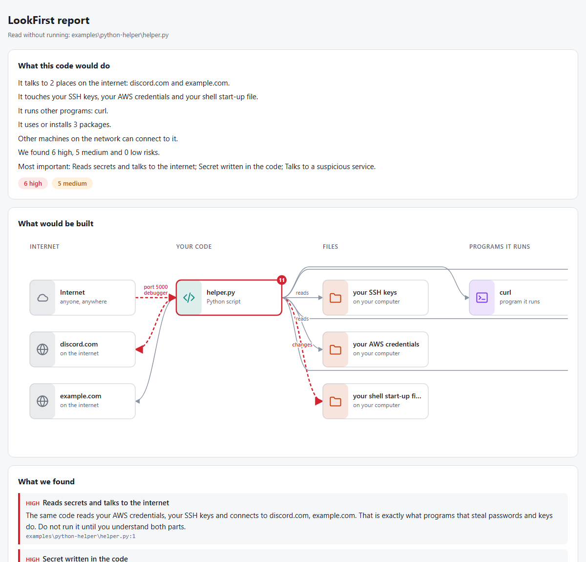

# LookFirst

**See what code does before you run it.**

Code from an AI assistant, a forum or a tutorial often works, and often does more than you think: it opens your server to the whole internet, writes passwords into files, downloads and runs other scripts, or makes itself start every time you log in. LookFirst reads the code, without running it, and shows you what it would do, as a picture and as a list of risks in plain English.

## Try it now, nothing to install

Open **[idris1980.github.io/lookfirst](https://idris1980.github.io/lookfirst/)**, paste some code or choose a file, and you get the picture and the list. Everything happens inside your browser: your code is not sent anywhere.

## Install it in VS Code

In VS Code, LookFirst checks your files while you work, and can ask an AI to explain a problem and suggest a fix.

1. Go to the newest [release](https://github.com/Idris1980/lookfirst/releases) and, under **Assets**, download the file for your computer. You only need one file, ending in `.vsix`; the others are for the [command line](docs/command-line.md) and for checking the download.

   | Your computer | File |
   | --- | --- |
   | Windows (almost all Windows computers) | `lookfirst-win32-x64-….vsix` |
   | Windows with an ARM chip, such as Snapdragon | `lookfirst-win32-arm64-….vsix` |
   | Mac with Apple chip (M1 or later) | `lookfirst-darwin-arm64-….vsix` |
   | Mac with Intel chip | `lookfirst-darwin-x64-….vsix` |
   | Linux | `lookfirst-linux-x64-….vsix` |

   Not sure? On Windows, open **Settings → System → About** and look at *System type*: "x64-based processor" means `win32-x64`.

2. In VS Code, open **Extensions** in the left bar (or press `Ctrl+Shift+X`, `Cmd+Shift+X` on a Mac).
3. Click **…** at the top of the Extensions list and choose **Install from VSIX…**.
4. Pick the file you downloaded. When VS Code says it is installed, you are done.

## Using it

- **Open a file.** LookFirst checks it straight away, and again every time you save, and right after you paste a larger piece of code.
- **Look at the bottom bar.** The shield shows how it went: red with *high* means something serious, yellow with *medium* means something worth a look, *no known risks* means LookFirst found nothing.
- **Look for squiggly lines.** Every problem is underlined in the code. Hover over it to read what is wrong and how to fix it. All problems are also listed under **Problems** (`Ctrl+Shift+M`).
- **See the picture.** Right-click the file, or a whole folder, and choose **Show in LookFirst**. Click a box in the picture, or a problem in the list, to jump to that line. A folder with several projects gets one picture per project, with the riskiest first.

## Ask the AI to explain a problem

Next to each problem in the picture, and in the light bulb on each squiggle, there is **Explain and fix with AI**. It is off until you turn it on, and it works like this:

1. LookFirst takes the lines around the problem, about 30 lines, not the whole file.
2. It replaces every password and key in them with a placeholder such as `«SECRET_1»`. The real values stay on your computer.
3. It shows you exactly the text it is about to send. You choose **Send** or **Cancel**, every time, unless you choose **Send, and stop asking**.
4. The answer explains the problem in plain language and suggests a fix, shown next to your code so you can compare.
5. Your file is changed only if you choose **Apply**. The real passwords are put back in at that moment, on your computer.

It uses the AI you already have in VS Code, such as GitHub Copilot; **Copilot Free** is enough and costs nothing. If you have a Claude plan and Claude Code, LookFirst can ask Claude through it instead, covered by your plan. Or use your own Anthropic API key (billed by Anthropic). The details are in the [extension's guide](vscode/README.md).

## What it looks for

- Servers and databases open to the whole internet
- Passwords, keys and tokens written into the code
- Storage that anyone can read
- Scripts that download other code and run it, or hide code and run it
- Code that reads your SSH keys, cloud logins or browser passwords
- Code that makes itself start automatically
- Commands that can delete much more than intended
- Antivirus, firewall or security checks being switched off
- Packages with names that look like misspellings of well-known ones
- Placeholders someone forgot to fill in, such as `"YOUR_IP_ADDRESS"`
- Syntax errors

It reads Terraform, Bicep and ARM templates, AWS CloudFormation and SAM templates, docker-compose, Kubernetes, Python, JavaScript and TypeScript, shell scripts, PowerShell, Dockerfiles, `package.json` and `requirements.txt`.

## Is it safe to use?

- **Your code is never run.** LookFirst only reads it, like a person reading a printout.
- **Nothing is sent anywhere**, except when you ask the AI and approve the exact text first.
- **The report cannot run anything.** It is a plain page with no scripts.
- **A downloaded project cannot change LookFirst.** The AI can only be turned on in your own settings.

How this is done, and how to check that a download really comes from this project, is described in [How LookFirst keeps you safe](docs/security.md).

## What it cannot do

LookFirst tells you what it found. It cannot promise that code is safe: code written on purpose to hide what it does can get past any tool that only reads it. Read what LookFirst shows you, and when in doubt, don't run it.

On the web page, Bicep files cannot be read, because they need Microsoft's Bicep compiler on your computer. Use VS Code for those.

## For developers

LookFirst also works outside VS Code:

- [On the command line](docs/command-line.md): one program for Windows, macOS and Linux, for scripts and build pipelines
- [On GitHub](docs/github-action.md): checks every pull request and marks the problems on the changed lines
- [Comparing a template with Azure](docs/compare-with-azure.md): asks Azure what a Bicep or ARM template would really build
- [Developing LookFirst](docs/development.md): building, testing and how the code is organised

## License

MIT
